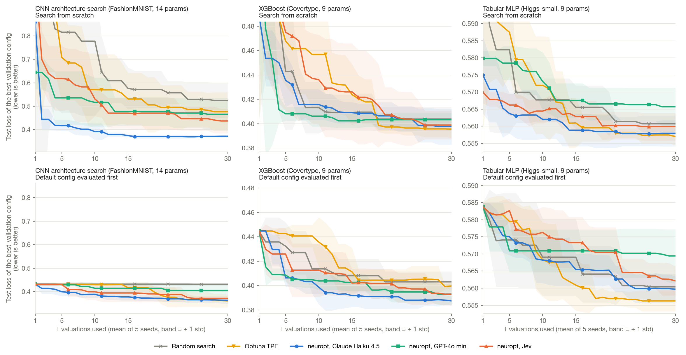

# neuropt

<p align="center">
  <a href="https://pypi.org/project/neuropt/"></a>
  <a href="https://github.com/loevlie/neuropt/actions/workflows/ci.yml"></a>
  <a href="https://github.com/loevlie/neuropt/blob/main/LICENSE"></a>
  <a href="https://pypi.org/project/neuropt/"></a>
  <a href="https://colab.research.google.com/github/loevlie/neuropt/blob/main/examples/neuropt_demo.ipynb"></a>
</p>

<p align="center">
  
</p>

<p align="center">
  <em>An LLM reads your training curves and designs your next experiment.</em>
</p>

---

<p align="center">
  <a href="https://loevlie.github.io/neuropt/quickstart/"><strong>Get started with neuropt →</strong></a>
</p>

Point it at a training script, let it run overnight. The LLM sees full per-epoch train/val curves, spots overfitting, and proposes what to try next — like a research assistant who never sleeps and actually reads the loss plots.

### vs Optuna and random search

<p align="center">
  
</p>

Three tasks, 30 evals per run, 5 seeds per method. Each task has a held-out test split that no optimizer or prompt ever sees; the number reported is the **test** loss of the config with the best validation loss. Mean ± std over seeds, lower is better.

| Search from scratch, after 30 evals | CNN (14 params) | XGBoost (9 params) | Tabular MLP (9 params) |
|---|:---:|:---:|:---:|
| Random search | 0.524 ± 0.075 | 0.404 ± 0.010 | 0.561 ± 0.002 |
| Optuna TPE | 0.477 ± 0.082 | 0.396 ± 0.007 | 0.557 ± 0.003 |
| neuropt, Claude Haiku 4.5 | **0.372 ± 0.004** | 0.398 ± 0.015 | 0.558 ± 0.004 |
| neuropt, GPT-4o mini | 0.466 ± 0.068 | 0.403 ± 0.006 | 0.566 ± 0.005 |
| neuropt, Jev decision model | 0.437 ± 0.053 | 0.399 ± 0.012 | 0.560 ± 0.004 |

| Default config evaluated first, after 30 evals | CNN | XGBoost | Tabular MLP |
|---|:---:|:---:|:---:|
| Random search | 0.432 ± 0.006 | 0.403 ± 0.009 | 0.560 ± 0.004 |
| Optuna TPE | 0.361 ± 0.028 | 0.400 ± 0.003 | 0.556 ± 0.003 |
| neuropt, Claude Haiku 4.5 | 0.363 ± 0.014 | **0.387 ± 0.004** | 0.560 ± 0.004 |
| neuropt, GPT-4o mini | 0.406 ± 0.026 | 0.393 ± 0.009 | 0.569 ± 0.008 |
| neuropt, Jev decision model | 0.371 ± 0.010 | 0.393 ± 0.010 | 0.562 ± 0.004 |

What this shows, using a rule fixed before the runs (better on average and on at least 4 of 5 seeds):

- **Where neuropt helps.** Searching the CNN space from scratch, Claude Haiku 4.5 beats Optuna TPE and random search on all 5 seeds, and is most of the way there after 5 evals (0.418, against 0.709 for TPE). On XGBoost with the default config first, it beats default-seeded TPE on all 5 seeds, by a small margin (0.387 against 0.400).
- **Where it doesn't.** If you already have a sensible default config for the CNN, Optuna TPE seeded with it does as well (0.361 against 0.363). On the tabular MLP no neuropt variant beats TPE, and GPT-4o mini is worse than TPE on all 5 seeds. On XGBoost from scratch there is no measurable difference between any of the methods.
- **Models differ.** GPT-4o mini only beats TPE in one of the six settings (XGBoost, default first). The Jev decision model beats TPE on the CNN from scratch, but is behind Claude Haiku 4.5 there.
- **Cost per 30-eval run.** Claude Haiku 4.5: about $0.06 on the CNN and MLP, $0.61 on XGBoost (long boosting curves make the prompts large). GPT-4o mini: $0.006 to $0.07. Jev: under $0.01.

Full protocol, per-run statistics (tokens, latency, parse failures) and the negative results are in [docs/evals.md](docs/evals.md). To reproduce: `python -m benchmarks.run && python -m benchmarks.plot`.

<p align="center">
  
</p>

## Quick start

```bash
pip install "neuropt[llm]"
export ANTHROPIC_API_KEY="sk-ant-..."
```

**Option 1** — define what to search over:

```python
# train.py
search_space = {
    "lr": (1e-4, 1e-1),                    # auto-detects log-scale
    "hidden_dim": (32, 512),                # auto-detects integer
    "activation": ["relu", "gelu", "silu"], # categorical
}

def train_fn(config):
    model = build_my_model(config["hidden_dim"], config["activation"])
    # ... train, return per-epoch losses for smarter LLM decisions ...
    return {"score": val_loss, "train_losses": [...], "val_losses": [...]}
```

**Option 2** — just give it a model, we figure out the rest:

```python
# train.py
model = torchvision.models.resnet18(num_classes=10)  # neuropt introspects this

def train_fn(config):
    m = config["model"].to("cuda")  # deep copy with modifications applied
    # ... train ...
    return {"score": val_loss, "train_losses": [...], "val_losses": [...]}
```

Then run:

```bash
neuropt run train.py
```

Runs until Ctrl+C. Crash-safe, resumable. Works in notebooks too:

```python
from neuropt import ArchSearch

search = ArchSearch(train_fn=train_fn, search_space=search_space, backend="claude")
search.run(max_evals=50)
```

### Or let a decision model choose (experimental)

> [!NOTE]
> **Still evaluating.** `DecisionSearch` works end to end, but it's new and its defaults may change as we benchmark it further.

`DecisionSearch` uses a [Jev](https://docs.typesafe.ai/concepts/system-one)-style **decision model** instead of a generative LLM. A decision model answers multiple-choice questions with calibrated probabilities instead of writing text. neuropt asks it one question per hyperparameter ("which `lr` range is most likely to beat the current best?"), samples candidates from its answers, then asks it to pick among them. The default is the open-weight [H2O-Lightning-4B](https://huggingface.co/h2oai/h2o-lightning-4b), which runs locally through llama.cpp (Apple Silicon included). Any server with the same `/v1/systemone` API also works, including hosted Jev.

Benchmarked with hosted Jev (`jev-latest`) in the same harness as above (5 seeds, 30 evals, test loss):

| Search from scratch | CNN | XGBoost | Tabular MLP | Cost per run | Time per model call |
|---|:---:|:---:|:---:|:---:|:---:|
| neuropt, Jev decision model | 0.437 ± 0.053 | 0.399 ± 0.012 | 0.560 ± 0.004 | under $0.01 | 0.3 s |
| neuropt, Claude Haiku 4.5 | 0.372 ± 0.004 | 0.398 ± 0.015 | 0.558 ± 0.004 | $0.06 to $0.61 | 2.7 to 4.0 s |
| Optuna TPE | 0.477 ± 0.082 | 0.396 ± 0.007 | 0.557 ± 0.003 | none | none |

Jev beats Optuna TPE on the CNN task (4 of 5 seeds) at about a tenth of Claude Haiku 4.5's cost, but Claude Haiku 4.5 is better there on 4 of 5 seeds. On the two tabular tasks there is no measurable difference between the three. With a default config evaluated first, Jev does not beat default-seeded TPE on the CNN or the MLP.

```python
from neuropt import DecisionSearch

search = DecisionSearch(train_fn=train_fn, search_space=search_space, backend="decision")
search.run(max_evals=50)
```

```bash
neuropt run train.py --decision-url http://gpu-box:8741
```

See [Decision Models](https://loevlie.github.io/neuropt/decision-models/) for server setup and how it decides.

## Documentation

See the [full documentation](https://loevlie.github.io/neuropt/) for:

- [How it works](https://loevlie.github.io/neuropt/how-it-works/) — what the LLM sees, training curve analysis
- [CLI reference](https://loevlie.github.io/neuropt/cli/) — `neuropt run`, `inspect`, `results`
- [Python API](https://loevlie.github.io/neuropt/api/) — `ArchSearch`, `from_model`, search space types
- [Model Introspection](https://loevlie.github.io/neuropt/introspection/) — `from_model()` auto-detection, activations, dropout, pooling
- [Fine-Tuning](https://loevlie.github.io/neuropt/fine-tuning/) — pretrained models, freeze strategies, L2-SP
- [Decision Models](https://loevlie.github.io/neuropt/decision-models/) — `DecisionSearch` with H2O-Lightning-4B or any Jev-compatible server (experimental)
- [Examples](https://loevlie.github.io/neuropt/examples/) — CNN search, ResNet tuning
- [Benchmarks](https://loevlie.github.io/neuropt/benchmarks/) — vs Optuna, random search

## Installation

```bash
pip install neuropt                  # core
pip install "neuropt[llm]"           # + Claude API (recommended)
pip install "neuropt[llm-openai]"    # + OpenAI API
pip install "neuropt[all]"           # everything
```

## License

MIT
