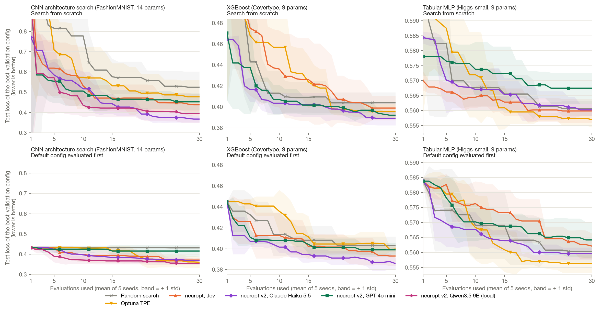

# Benchmarks

neuropt is compared with random search and Optuna TPE on three tasks, with a held-out test split that
no optimizer or prompt sees, 30 evals per run and 5 seeds per method. The number reported is the test
loss of the config with the best validation loss (mean ± std, lower is better).

{ width="900" }

| Search from scratch | CNN (14 params) | XGBoost (9 params) | Tabular MLP (9 params) |
|---|:---:|:---:|:---:|
| Random search | 0.524 ± 0.075 | 0.404 ± 0.010 | 0.561 ± 0.002 |
| Optuna TPE | 0.477 ± 0.082 | 0.396 ± 0.007 | 0.557 ± 0.003 |
| neuropt, Claude Haiku 5.5 (default) | 0.367 ± 0.017 | 0.392 ± 0.004 | 0.560 ± 0.002 |
| neuropt, GPT-4o mini | 0.452 ± 0.042 | 0.392 ± 0.003 | 0.567 ± 0.005 |
| neuropt, Qwen3.5 9B (local, Ollama) | 0.395 ± 0.045 | | |
| neuropt, Jev decision model | 0.437 ± 0.053 | 0.399 ± 0.012 | 0.560 ± 0.004 |

| Default config evaluated first | CNN | XGBoost | Tabular MLP |
|---|:---:|:---:|:---:|
| Random search | 0.432 ± 0.006 | 0.403 ± 0.009 | 0.560 ± 0.004 |
| Optuna TPE | 0.361 ± 0.028 | 0.400 ± 0.003 | 0.556 ± 0.003 |
| neuropt, Claude Haiku 5.5 (default) | 0.369 ± 0.011 | 0.388 ± 0.003 | 0.560 ± 0.002 |
| neuropt, GPT-4o mini | 0.416 ± 0.031 | 0.399 ± 0.007 | 0.564 ± 0.006 |
| neuropt, Qwen3.5 9B (local, Ollama) | 0.354 ± 0.006 | | |
| neuropt, Jev decision model | 0.371 ± 0.010 | 0.393 ± 0.010 | 0.562 ± 0.004 |

## What to take from it

- **neuropt is most useful when you start from nothing on an architecture search.** On the CNN space
  Claude Haiku 5.5 beats TPE on 4 of 5 seeds and is most of the way there after 5 evals.
- **A good default config closes that gap.** TPE seeded with a textbook CNN config matches it.
- **On tabular tasks the differences are small.** On XGBoost neuropt beats TPE, by about 0.01 log
  loss with the defaults evaluated first; on the MLP TPE is better than every neuropt variant.
- **The model matters.** GPT-4o mini is clearly weaker than Claude Haiku 5.5 here; a local Qwen3.5 9B
  is close behind it on the CNN.

The protocol, the decision rule (fixed before the runs), per-run cost and latency, and the negative
results are on the [Evaluations](evals.md) page.

## Run it yourself

```bash
pip install "neuropt[llm]" optuna xgboost torch torchvision scikit-learn matplotlib
export ANTHROPIC_API_KEY="sk-ant-..."

python -m benchmarks.run      # from a clone of the repository; finished runs are skipped
python -m benchmarks.plot     # figures and tables
```

Methods whose API key is missing are skipped and reported, never replaced by random search.
The older single-seed scripts in `examples/benchmark*.py` are kept for quick experiments; their
numbers are not comparable with the ones above (see [Evaluations](evals.md), Phase 0).
