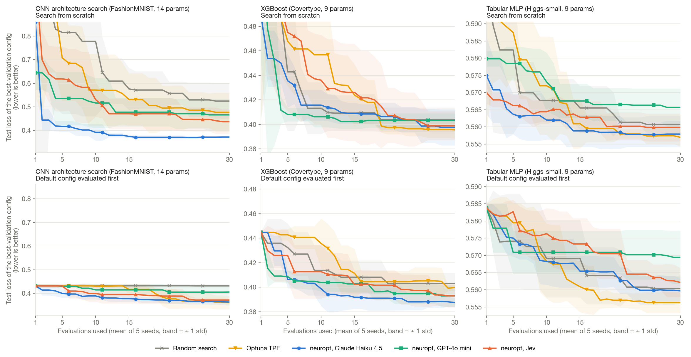

# Evaluations

How neuropt is evaluated, what was decided before looking at results, and what was found, including
negative results. Everything here is produced by the harness in `benchmarks/`:

```bash
python -m benchmarks.run     # every task x method x seed; finished runs are skipped
python -m benchmarks.plot    # figures and tables from the cached runs
```

## Protocol (fixed 19 Nov 2026, before any harness run)

**Tasks.** Each has a fixed train / val / test split (data seed fixed, independent of the run seed).

| Task | Data | Train / val / test | Search space |
|---|---|---|---|
| `cnn` | FashionMNIST, 32x32 | 5,000 / 1,250 (both from the official training split) / 10,000 (official test split) | 14 params, architecture + training, 5 epochs |
| `xgb` | Covertype, 7 classes | 16,000 / 4,000 / 10,000 (disjoint random rows) | 9 XGBoost params |
| `mlp` | Higgs-small (OpenML 23512) | 20,000 / 5,000 / 20,000 (disjoint random rows) | 9 params, 10 epochs |

**What the optimizer sees.** Only train and validation information: the validation loss as the score,
validation accuracy, and per-epoch train / val curves. The test split is scored by the harness for
every trained config and written to the result file; it is never returned to an optimizer and never
appears in a prompt or a decision-model state. `tests/test_benchmarks.py` checks this with a canary.

**Reported number.** At each eval count, take the config with the best validation loss so far (the
incumbent) and report its **test** loss. Validation best-so-far is shown next to it.

**Methods.**

| Method | What it is |
|---|---|
| `random` | Uniform random search |
| `tpe` | Optuna TPE with Optuna's default settings |
| `neuropt-<model>` | `ArchSearch` with that LLM, batch size 3. Phase 1 uses the package's two API defaults, `haiku-4.5` and `gpt-4o-mini` (the second was added on 19 Nov 2026 after the classical arms had run, when the Anthropic account ran out of credit; no LLM results had been looked at for it) |
| `jev` | `DecisionSearch` with hosted Jev (`jev-latest`) |
| `<method>+default` | The same method, but its first eval is the task's default config |

The `+default` variants are the control from arXiv 2606.21641, which found that an LLM advisor's
advantage on tabular HPO came from the default config it started with. A `+default` LLM arm is
compared with `tpe+default` and `random+default`, never with an unseeded baseline.

**Default configs** (fixed here, not tuned): XGBoost's library defaults (regularisation terms that
default to 0 are set to the lower bound of their log range); for the CNN and MLP a plain textbook
setup (AdamW, lr 1e-3, ReLU, batch norm). The exact values are in `benchmarks/tasks.py`.

**Budget and fairness.**

- 30 evals per run, reported at 5, 10, 15 and 30. Every eval counts, including failed ones.
- A failed eval (error, non-finite loss, or over the time limit) scores as a uniform guess,
  `ln(n_classes)`. The same time limit applies to every method.
- 5 seeds (0 to 4) per method and task. The run seed sets the optimizer's randomness and the
  training seed of each eval, so every method trains with the same sequence of training seeds.
- Also recorded per run: wall-clock time, tokens, API cost, LLM latency, parse failures, LLM errors,
  duplicate configs, and how many evals fell back to random configs.

**Decision rule.** Variant A "helps" over B on a task only if both hold at 30 evals:

1. A's mean incumbent test loss over the 5 seeds is lower than B's, and
2. A is better than B on at least 4 of the 5 seeds (paired by seed).

Anything else is reported as "no measurable difference". A change goes into the package defaults only
if it helps on at least 2 of the 3 tasks and is not worse (by the same rule) on the third. Cost is
reported next to every score; a variant that helps but costs more is described as such.

## Phase 0: what the old benchmark showed (19 Nov 2026)

Re-running the README benchmark scripts (one seed, 15 evals, M1 Max) before building the harness:

| Best val loss after 15 evals | CNN | XGBoost Covertype |
|---|:---:|:---:|
| neuropt, Claude Haiku 4.5 | 0.371 (README: 0.385) | 0.425 (docs: about 0.414) |
| Optuna TPE (`n_startup_trials=3`) | 0.392 (README: 0.454) | 0.443 (docs: 0.415) |
| Random search | 0.624 (README: 0.610) | 0.418 (docs: 0.418) |
| neuropt, hosted Jev | 0.332 | 0.511 |

Problems with that benchmark, which the protocol above fixes:

1. No held-out test set. The CNN "validation" set was a subset of the FashionMNIST test split, and the
   score shown to the optimizer was the score reported.
2. One seed, and training itself was unseeded. Optuna moved from 0.454 to 0.392 between two runs of
   the same script, which is most of its published gap to Claude.
3. Failed evals were dropped from the curves, so "best after N" meant N successes, not N evals.
4. Only the neuropt arms had a time limit on the CNN task.
5. No default-seeded baseline.
6. The local Qwen backend failed on every call with transformers 4.53 (`dtype` argument) and ran as
   random search while still being labelled as Qwen.
7. On XGBoost, random search beat neuropt with Claude Haiku 4.5 in this run.

## Phase 1 results: current defaults against baselines (20 Nov 2026)

5 seeds, 30 evals, test loss of the best-validation config. Full tables, including per-run tokens,
latency and cost, are in [`benchmarks/results.md`](https://github.com/loevlie/neuropt/blob/main/benchmarks/results.md);
the raw runs are in `benchmarks/runs/`.



| Search from scratch | CNN | XGBoost | Tabular MLP |
|---|:---:|:---:|:---:|
| Random search | 0.524 ± 0.075 | 0.404 ± 0.010 | 0.561 ± 0.002 |
| Optuna TPE | 0.477 ± 0.082 | 0.396 ± 0.007 | 0.557 ± 0.003 |
| neuropt, Claude Haiku 4.5 | 0.372 ± 0.004 | 0.398 ± 0.015 | 0.558 ± 0.004 |
| neuropt, GPT-4o mini | 0.466 ± 0.068 | 0.403 ± 0.006 | 0.566 ± 0.005 |
| neuropt, Jev | 0.437 ± 0.053 | 0.399 ± 0.012 | 0.560 ± 0.004 |

| Default config first | CNN | XGBoost | Tabular MLP |
|---|:---:|:---:|:---:|
| Random search | 0.432 ± 0.006 | 0.403 ± 0.009 | 0.560 ± 0.004 |
| Optuna TPE | 0.361 ± 0.028 | 0.400 ± 0.003 | 0.556 ± 0.003 |
| neuropt, Claude Haiku 4.5 | 0.363 ± 0.014 | 0.387 ± 0.004 | 0.560 ± 0.004 |
| neuropt, GPT-4o mini | 0.406 ± 0.026 | 0.393 ± 0.009 | 0.569 ± 0.008 |
| neuropt, Jev | 0.371 ± 0.010 | 0.393 ± 0.010 | 0.562 ± 0.004 |

Verdicts by the decision rule, each neuropt arm against Optuna TPE with the same seeding
(seeds better / worse in brackets):

| | CNN | XGBoost | Tabular MLP |
|---|---|---|---|
| Claude Haiku 4.5, from scratch | helps (5 / 0) | no difference (3 / 2) | no difference (2 / 3) |
| Claude Haiku 4.5, default first | no difference (3 / 2) | helps (5 / 0) | no difference (2 / 3) |
| GPT-4o mini, from scratch | no difference (3 / 2) | no difference (2 / 3) | worse (0 / 5) |
| GPT-4o mini, default first | worse (0 / 5) | helps (4 / 1) | worse (0 / 5) |
| Jev, from scratch | helps (4 / 1) | no difference (2 / 3) | no difference (2 / 3) |
| Jev, default first | worse (1 / 4) | helps (4 / 1) | worse (1 / 4) |

**What holds up.**

- From scratch on the CNN space, Claude Haiku 4.5 beats TPE and random search on every seed, and
  most of the gain is there after 5 evals (0.418, against 0.709 for TPE and 0.816 for random).
- With the default first on XGBoost, all three neuropt arms beat default-seeded TPE. The margins
  are small (0.007 to 0.012 in log loss).

**Negative results.**

- No neuropt arm helps on 2 of the 3 tasks against TPE under the same seeding, which was the bar
  for a general claim. The honest summary is "helps in some settings".
- The CNN advantage is mostly the model knowing a good starting point. Give TPE a textbook default
  config and it matches Claude Haiku 4.5 (0.361 against 0.363). This is the effect reported in
  arXiv 2606.21641. The default config alone scores 0.432, better than unseeded TPE after 30 evals.
- On the tabular MLP nothing beats TPE, and GPT-4o mini is worse on every seed, seeded or not.
- GPT-4o mini, the OpenAI default, is the weakest arm: it beats TPE in 1 of 6 settings and is
  worse in 3.
- Jev is behind Claude Haiku 4.5 on the CNN (worse on 4 of 5 seeds). The single-seed Phase 0 run
  that had Jev ahead did not hold up.
- Claude Haiku 4.5 returned unusable JSON on 18 of 100 calls on the MLP task and 4 of 101 on the
  CNN, so 53 of 300 MLP evals and 12 of 300 CNN evals were random fallbacks. GPT-4o mini failed on
  1 of 300 calls. The cause on the MLP task has not been examined yet; fixing it (structured
  outputs) is Phase 2.
- Cost: a 30-eval XGBoost run with Claude Haiku 4.5 costs $0.61, eleven times the CNN run, because
  full 500-round boosting curves are put in every prompt.

**Caveats.**

- The CNN ran on an RTX 4090; XGBoost and the MLP ran on an M1 Max, two tasks at a time, so their
  wall-clock times are inflated and not comparable with the CNN's.
- `neuropt-gpt-4o-mini` was added after the classical arms had finished (see Methods).
- 5 seeds per arm. Differences of a few thousandths between arms are within noise unless the
  table above says otherwise.

Total API spend for these runs: about $7.20 Anthropic, $0.76 OpenAI, $0.17 Jev.
